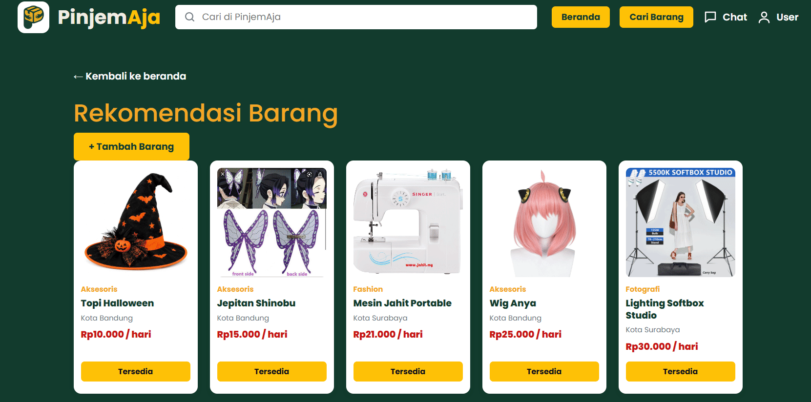


# Pinjem Aja

**Topik Utama:** Sustainable Consumption

Pinjem Aja adalah platform berbasis komunitas untuk meminjam dan meminjamkan barang agar barang yang jarang digunakan dapat dimanfaatkan kembali oleh orang lain.

🔗 **Deployment PWS:** [PinjemAja - Pinjam Barang, Jangan Beli](https://khanyfatul-muflikhat-pinjemaja.pws.cs.ui.ac.id/)

🎨 **Desain Figma:** [Wireframe PinjemAja – Figma](https://www.figma.com/design/6dKz48JAYCguCmL9fVptaa/Wireframe-PinjemAja?node-id=0-1&p=f&t=ZN2o0JN1opeWuIMw-0)

---

## Daftar Isi

- [Anggota Kelompok](#anggota-kelompok)
- [Deskripsi Aplikasi](#deskripsi-aplikasi)
- [Alur Pinjam Barang](#alur-pinjam-barang)
- [Jenis dan Peran Pengguna](#jenis-dan-peran-pengguna)
- [Fitur dan Modul](#fitur-dan-modul)
- [Teknologi dan Integrasi API](#teknologi-dan-integrasi-api)
- [Instalasi dan Konfigurasi](#instalasi-dan-konfigurasi)
- [Checkpoint Progress](#checkpoint-progress)
- [AI Disclosure](#ai-disclosure)
- [Batasan dan Pengembangan Lanjutan](#batasan-dan-pengembangan-lanjutan)

---

## Anggota Kelompok

| NPM | Nama |
| --- | --- |
| 2506656614 | Della Permata Prasilda |
| 2506656835 | Joceline Nadine Immanuella |
| 2506533614 | Fatma Widya Rachma |
| 2506589755 | Khanyfatul Muflikhat |
| 2506604573 | Nafeeza Arwatabina |

---

## Deskripsi Aplikasi

Pinjem Aja adalah platform berbasis komunitas yang memungkinkan pengguna meminjam dan meminjamkan barang. Pengguna dapat mengunggah barang yang sedang tidak digunakan, melengkapi informasi barang, dan menentukan harga sewa. Pengguna lain dapat mencari barang berdasarkan kategori, lokasi, ketersediaan, dan kondisi sebelum mengajukan peminjaman.

## Alur Pinjam Barang




### Masalah yang Diselesaikan

- Barang sering dibeli meskipun hanya digunakan sesekali.
- Banyak barang yang dimiliki seseorang belum dimanfaatkan secara maksimal.
- Sulit menemukan barang yang dapat dipinjam dari orang di sekitar.

Pinjem Aja mendorong penggunaan barang secara bersama agar pengguna tidak selalu perlu membeli barang baru untuk kebutuhan sementara. Dengan demikian, aplikasi ini mendukung pola konsumsi yang lebih berkelanjutan sekaligus memperkuat kebiasaan berbagi di lingkungan kampus dan tempat tinggal.

## Jenis dan Peran Pengguna

- **Peminjam:** Mahasiswa atau individu yang membutuhkan barang untuk jangka waktu tertentu.
- **Pemilik Barang:** Pengguna yang menawarkan barang miliknya untuk disewakan atau dipinjam oleh pengguna lain.
- **Komunitas:** Kelompok, organisasi, atau lingkungan tempat tinggal yang dapat berbagi barang untuk digunakan bersama.

---

## Fitur dan Modul

| No. | Modul | Deskripsi | Penanggung Jawab |
| --- | --- | --- | --- |
| 1 | Barang | Pemilik dapat membuat, melihat, mengubah, dan menghapus listing; listing mendukung kategori, kondisi, harga, status ketersediaan, dan beberapa foto. | Della Permata Prasilda |
| 2 | Transaksi | Pengajuan dengan tanggal dan metode pengambilan, persetujuan atau penolakan pemilik, pembayaran transfer atau COD, unggah bukti pembayaran, pembatalan, perubahan status, dan rating pemilik. | Nafeeza Arwatabina |
| 3 | Pencarian, Filter, dan Lokasi | Pencarian nama/deskripsi, filter kategori, lokasi, kondisi, dan rentang harga, serta pengurutan hasil. Pencarian juga tersedia melalui endpoint JSON untuk pembaruan halaman secara dinamis. | Joceline Nadine Immanuella |
| 4 | Profil | Registrasi, login (dengan rate limiting), profil pribadi dan publik, edit profil (avatar, email, alamat bertingkat, data pembayaran), hapus avatar, nonaktifkan akun, dan hapus akun permanen. | Khanyfatul Muflikhat |
| 5 | Chat | Percakapan dan pengelolaan pesan antar pengguna. Pesan dan sidebar diperbarui berkala melalui polling browser. | Fatma Widya Rachma |

---

## Teknologi dan Integrasi API

### Teknologi Utama

- **Python 3.13 dan Django 5.2:** Pengembangan aplikasi web menggunakan pola Model-Template-View (MTV).
- **Bootstrap 5, HTML dan CSS:** Struktur serta tampilan antarmuka.
- **JavaScript:** Interaksi antarmuka pada sisi klien.
- **Database:** Penyimpanan data pengguna, barang, dan transaksi.
- **Git dan GitHub:** Version control dan kolaborasi pengembangan.
- **PWS:** Deployment aplikasi agar dapat diakses secara publik.
- **Pillow:** Untuk pemrosesan gambar, WhiteNoise untuk penyajian static files.


### Public API

**OpenStreetMap / Overpass API**

API ini digunakan untuk mendukung kebutuhan data lokasi pada fitur pencarian dan pemetaan.

Dokumentasi: [Overpass API](https://wiki.openstreetmap.org/wiki/Overpass_API)

**API Wilayah Indonesia**
API ini sebagai sumber data provinsi, kota/kabupaten, kecamatan, dan kelurahan untuk dropdown alamat bertingkat.

---

## Instalasi dan Konfigurasi

Bagian ini menjelaskan langkah umum untuk menjalankan proyek secara lokal.

### Prasyarat

Pastikan perangkat telah memiliki:

- Python dengan versi yang sesuai dengan proyek.
- Git.
- pip untuk mengelola package Python.

### 1. Clone Repository

```bash
git clone <URL_REPOSITORY>
cd <FOLDER_PROYEK>
```

Ganti URL repository dan nama folder sesuai repository PinjemAja yang digunakan.

### 2. Buat Virtual Environment

```bash
python -m venv venv
```

Aktifkan virtual environment sesuai sistem operasi.

**Windows:**

```bash
venv\Scripts\activate
```

**macOS/Linux:**

```bash
source venv/bin/activate
```

### 3. Instal Dependencies

Jika repository menyediakan `requirements.txt`, jalankan:

```bash
pip install -r requirements.txt
```

### 4. Konfigurasi Environment

Atur variabel environment yang dibutuhkan sesuai konfigurasi proyek. Jangan mengunggah password, secret key, token API, atau kredensial database ke repository publik.

Jika proyek menggunakan file `.env`, buat file tersebut berdasarkan konfigurasi yang diperlukan dan jangan mengisi nilainya dengan kredensial contoh untuk lingkungan produksi.

### 5. Jalankan Migrasi Database

```bash
python manage.py migrate
```

### 6. Jalankan Server Lokal

```bash
python manage.py runserver
```

Buka alamat berikut pada browser:

```text
http://127.0.0.1:8000/
```

**Catatan:** 
- Ganti <URL_REPOSITORY> dengan URL repository Git proyek.
- Secara default, pengembangan lokal menggunakan SQLite dan tidak memerlukan .env. Konfigurasi production memilih PostgreSQL saat PRODUCTION=True dan membaca DB_NAME, DB_USER, DB_PASSWORD, DB_HOST, DB_PORT, serta SCHEMA dari environment. Isi environment variable production melalui pengaturan rahasia platform deploy, bukan dengan mengunggah kredensial ke Git.
- Menjalankan test dengan 
```bash
python manage.py migrate
```

---

## Checkpoint Progress

### Checkpoint 1 — Inisialisasi Proyek

- Membuat repository dan struktur awal proyek Django.
- Menyiapkan fondasi pengembangan aplikasi bersama.
- Membagi tanggung jawab pengembangan ke dalam modul-modul utama.

### Checkpoint 2 — Design System dan Deployment Pertama

- Menyepakati template dasar dan design system, termasuk palet warna serta komponen antarmuka bersama.
- Melakukan implementasi awal pada struktur dan tampilan aplikasi.
- Berhasil melakukan deployment awal ke PWS.

🔗 [Buka Deployment PinjemAja](https://khanyfatul-muflikhat-pinjemaja.pws.cs.ui.ac.id/)

🎨 [Buka Wireframe Figma](https://www.figma.com/design/6dKz48JAYCguCmL9fVptaa/Wireframe-PinjemAja?node-id=0-1&p=f&t=ZN2o0JN1opeWuIMw-0)

---

## AI Disclosure

Selama pengembangan PinjemAja, tim menggunakan alat AI generatif, termasuk ChatGPT/Codex, DeepSeek, dan alat lain sesuai kebutuhan. AI digunakan sebagai pendamping untuk memahami kode, mendiskusikan implementasi, menganalisis kemungkinan penyebab bug, mengeksplorasi alternatif solusi, memperbaiki kode, dan menyusun dokumentasi.

AI tidak menjadi sumber data aplikasi dan tidak mengambil keputusan persetujuan transaksi. Data aplikasi berasal dari pengguna dan disimpan dalam database proyek, sedangkan keputusan akhir terkait desain dan implementasi tetap berada pada tim pengembang.

### 1. AI Tools Used

| Alat AI | Tujuan Penggunaan |
| --- | --- |
| ChatGPT / Codex | Membantu memahami struktur kode, mendiskusikan implementasi fitur, menganalisis bug, dan mengeksplorasi perbaikan kode. |
| DeepSeek | Membantu memahami konsep pemrograman dan membandingkan alternatif penyelesaian masalah. |
| Alat AI lainnya | Digunakan sesuai kebutuhan pengembangan, apabila relevan dengan tugas yang sedang dikerjakan. |

### 2. Prompt Strategy

Tim menggunakan prompt secara bertahap dan kontekstual, bukan meminta AI membuat keseluruhan aplikasi sekaligus. Prompt menjelaskan tujuan fitur, perilaku yang diharapkan, peran pengguna, struktur Django MTV, file atau potongan kode terkait, dan batasan implementasi.

Untuk antarmuka, hasil AI dibandingkan dengan wireframe Figma dan kebutuhan desain. Jika hasil awal belum sesuai, tim memberikan konteks atau arahan tambahan untuk memperbaiki solusi.

### 3. Human Review and Manual Corrections

Hasil AI tidak langsung dianggap benar atau siap digunakan. Implementasi perlu diperiksa berdasarkan model, URL, view, template, JavaScript, CSS, dan alur antarmodul yang benar-benar ada pada proyek.

Beberapa contoh peninjauan yang dilakukan selama pengembangan meliputi:

- **Modul Transaksi:** Alur transaksi disesuaikan dengan peran peminjam dan pemilik serta status transaksi. Pada daftar transaksi, relasi terhadap `request.user` digunakan untuk menentukan transaksi yang relevan tanpa menambahkan context `is_peminjam` yang redundan.
- **Antarmuka:** CSS dan tata letak disesuaikan kembali ketika hasil awal belum sesuai dengan desain yang diharapkan.
- **Integrasi Modul:** Kesesuaian URL, relasi model, template, dan interaksi JavaScript perlu diperiksa agar implementasi selaras dengan struktur proyek.
- **Kode dan Dokumentasi:** Solusi ditinjau agar tidak menambahkan logika yang tidak diperlukan serta tetap mengikuti pola pengembangan proyek.

### 4. AI Limitations and Risk Mitigation

AI membantu mempercepat eksplorasi solusi, tetapi memiliki keterbatasan yang perlu diperhatikan:

- **Konteks tidak lengkap:** AI dapat memberikan solusi yang tidak sesuai jika struktur proyek atau kebutuhan fitur tidak dijelaskan secara lengkap.
- **Kesalahan logika:** AI dapat keliru memahami nama status, relasi model, URL, atau alur transaksi.
- **Risiko keamanan:** Kode yang terlihat benar belum tentu memiliki otorisasi dan validasi input yang memadai, terutama pada akun, transaksi, dan unggahan berkas.
- **Ketidaksesuaian UI:** CSS yang dihasilkan AI belum tentu sesuai dengan wireframe atau responsivitas yang diharapkan.
- **Pengujian yang terbatas:** Saran AI tidak membuktikan bahwa kode bebas bug, konsisten dengan database, atau kompatibel dengan semua browser.

Untuk mengurangi risiko tersebut, hasil AI perlu ditinjau secara kritis dan dicocokkan dengan kebutuhan aplikasi. Perubahan sebaiknya divalidasi melalui pemeriksaan kode, pengujian Django, dan uji manual di browser sesuai fitur yang diubah.

Pengujian tidak boleh dianggap berhasil hanya karena AI menyatakan bahwa solusi sudah benar. Hasil pengujian hanya dicantumkan sebagai berhasil apabila benar-benar telah dijalankan.

### 5. Examples of AI-Assisted Development

#### Case 1: Transaction Logic and User Roles

- **Kebutuhan:** Daftar transaksi harus menampilkan transaksi yang relevan bagi pengguna yang sedang login.
- **Bantuan AI:** AI digunakan untuk mendiskusikan alternatif implementasi logika transaksi dan penanganan peran pengguna.
- **Peninjauan manual:** Implementasi disesuaikan dengan relasi transaksi dan `request.user`, sehingga informasi transaksi dapat ditentukan berdasarkan hubungan data tanpa context `is_peminjam` yang redundan.
- **Pembelajaran:** Solusi AI perlu dievaluasi berdasarkan struktur model dan kebutuhan aplikasi, bukan langsung diterapkan.

#### Case 2: UI Styling and Design Consistency

- **Kebutuhan:** Tampilan aplikasi harus sesuai dengan wireframe dan design system yang telah disepakati.
- **Bantuan AI:** AI digunakan untuk mengeksplorasi alternatif CSS dan perbaikan tata letak.
- **Peninjauan manual:** Hasil styling dibandingkan dengan desain yang diharapkan, kemudian disesuaikan ketika tampilan awal belum sesuai.
- **Pembelajaran:** CSS yang dihasilkan AI tetap membutuhkan evaluasi visual dan penyesuaian berdasarkan kebutuhan proyek.


### 6. Responsibility and Final Decisions

AI digunakan untuk mendukung produktivitas, pembelajaran, dan eksplorasi solusi. AI tidak menggantikan proses berpikir kritis, kolaborasi, atau tanggung jawab pengembang.

Tim bertanggung jawab untuk meninjau saran AI, menentukan solusi yang sesuai, memperbaiki implementasi, dan memvalidasi hasil sesuai kebutuhan aplikasi. Keputusan akhir terkait desain, implementasi, dan kode yang digunakan tetap berada pada tim pengembang.

---

## Batasan dan Pengembangan Lanjutan

Pengembangan PinjemAja dapat dilanjutkan dengan peningkatan pada aspek berikut:

- Meningkatkan konsistensi antarmuka dan responsivitas pada berbagai ukuran layar.
- Memperkuat validasi input dan pemeriksaan hak akses pengguna.
- Memperluas pengujian alur peminjaman, status transaksi, dan interaksi antarmodul.
- Meningkatkan penanganan kesalahan ketika layanan eksternal tidak tersedia.
- Menyempurnakan dokumentasi teknis dan panduan penggunaan aplikasi.


